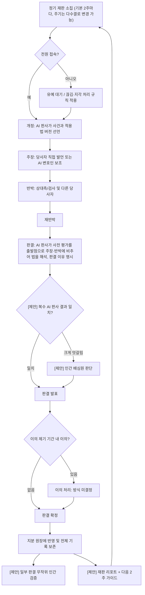

# pie-court 설계 문서

> 상태: 초안 (v0.8). 구현 코드는 아직 없습니다.
>
> 이 문서의 표기 규칙
> - **[결정]** 프로젝트 오너가 확정한 사항
> - **[제안]** 검토용으로 제시된 기능·아이디어. 채택 여부 미정
> - **[권장안]** 기술 선택 등에 대한 추천. 결정이 아님
> - 그 외 정해지지 않은 사항은 [11. 미결정 사항](#11-미결정-사항-open-questions)에 모읍니다.

---

## 목차

1. [목표와 철학](#1-목표와-철학)
2. [역할](#2-역할)
3. [핵심 흐름 개요](#3-핵심-흐름-개요)
4. [화면별 흐름](#4-화면별-흐름)
5. [재판 흐름도](#5-재판-흐름도)
6. [품질 기여도 평가 방식](#6-품질-기여도-평가-방식)
7. [지분 원장 (Share Ledger)](#7-지분-원장-share-ledger)
8. [입법: 판정 기준의 개정](#8-입법-판정-기준의-개정)
9. [데이터 모델 스케치](#9-데이터-모델-스케치)
10. [기술 아키텍처 (권장안)](#10-기술-아키텍처-권장안)
11. [미결정 사항 (Open Questions)](#11-미결정-사항-open-questions)
12. [참고 프로젝트](#12-참고-프로젝트)

---

## 1. 목표와 철학

### 문제

개인 게임 개발자가 협업을 하고 싶어도 **지분·수익 배분이 너무 어렵기 때문에** 협업 자체가 막힙니다. 누가 얼마나 기여했는지 사람끼리 직접 따지면 감정이 상하고, 미리 정한 고정 공식은 프로젝트가 진행되며 금방 현실과 어긋납니다.

### pie-court가 하는 일

pie-court는 각 협업자의 기여를 판정하고 지분을 계산하는 **"AI 법정" 웹 앱**입니다.

### 핵심 철학

- **정답을 맞히는 시스템이 아닙니다.** 기여 평가에 고정된 정답은 없고, 기준은 팀과 프로젝트에 따라 유동적입니다.
- 시스템의 역할은 그 **유동적인 기준을 붙잡아(명문화하고), 팀의 다수가 납득할 수 있는 절충안**을 만들어 내는 것입니다.
- **[결정] 부가 목표: 기여자들의 열의를 끌어올리기.** 지분을 공정하게 나누는 것에 더해, 정기 재판과 판결을 통해 기여가 인정받고 눈에 보이게 하여 팀원의 동기와 열의를 높이는 것도 이 프로젝트의 가치입니다 ([1.1](#11-부가-목표-기여자들의-열의-끌어올리기)).
- 이를 위해 판정 기준은 팀의 "법"으로 다루고, 법은 팀이 제안·투표로 개정합니다 ([8장](#8-입법-판정-기준의-개정)).
- **[결정] 법은 기계적 공식이 아니라 "기준"입니다.** 루브릭, 가중치, 지분율 계산식은 판단의 출발점이 되는 기준일 뿐입니다. 진짜 법정처럼, 판결은 그 기준에 근거한 당사자들의 주장과 반박에 따라 유연하게 달라집니다. AI 판사는 숫자를 대입하는 계산기가 아니라, 주장에 비추어 법을 **해석**하고 판결 이유를 밝히는 판사입니다.
- **[결정] 평가는 결과론적(전체 평가)입니다.** 법(루브릭 또는 지분율 계산식)이 바뀌면 과거의 모든 기여를 새 법으로 다시 평가·재계산합니다. 이전 결과는 스냅샷으로 남겨 감사할 수 있게 합니다 ([7장](#7-지분-원장-share-ledger)).
- **[결정] 평가의 주 기준은 "최종 결과물 품질에 대한 기여"이며, 투입 시간은 점수에서 제외합니다.** ([6장](#6-품질-기여도-평가-방식))
- **[결정] Slicing Pie의 시간·금액 시장가치 모델은 사용하지 않습니다.** Slicing Pie에서는 "지분이 계속 누적되고 재계산되는 원장"이라는 아이디어만 빌려옵니다 ([7장](#7-지분-원장-share-ledger)).

### 확정된 결정 요약

| # | 결정 |
|---|------|
| 1 | 브라우저 기반 **웹 앱**. 접근성을 위해 **법정 형태의 GUI** 사용 |
| 2 | 재판은 **모든 당사자가 동시에 접속한 실시간 재판**. 모두가 집중하는 중요한 의사결정 자리. 전체 재판 기록 보존, 판결 후 짧은 이의 제기 기간, 접속 끊김·지각 처리 |
| 3 | 각 당사자는 **직접 자기 권리를 주장**할 수 있고, **AI 변호인**을 선임해 도움을 받을 수 있음. 상대측(검사/반대측)과 **AI 판사** 역할 존재 |
| 4 | **Git 커밋이 기본 증거.** AI는 줄 수·커밋 수가 아니라 **커밋 내용(diff)** 을 읽음 |
| 5 | 주 기준은 **최종 결과물 품질 기여**. 시간은 점수에서 제외. Slicing Pie 시장가치 모델 미사용, 누적·재계산 원장 아이디어만 차용 |
| 6 | 판정 기준(가중치, 루브릭)은 팀의 **법**이며 제안·투표로 개정. **결과론적 전체 평가**: 법(루브릭 또는 지분율 계산식)이 바뀌면 **과거의 모든 기여를 새 법으로 재평가·재계산** |
| 7 | 재판은 **정기적으로** 열림. 기본 **2주에 한 번**. 주기 자체도 법률 항목이며 **다수결로 변경 가능** |
| 8 | 부가 목표: 지분 계산뿐 아니라 **기여자들의 열의를 끌어올리기** |
| 9 | **지분율 계산 방식**(품질 점수를 지분 %로 환산하는 방법)은 시스템이 고정하지 않음. 팀의 **법률 항목** |
| 10 | **AI·운영 비용 부담**은 기본 규칙에 포함하지 않음. 필요하면 팀이 나중에 **법률로 추가**할 수 있는 항목 (기본값: 없음) |
| 11 | **법은 공식이 아닌 기준**. 루브릭 점수·계산식은 출발점이고, 그 기준에 근거한 주장·반박으로 판결이 유연하게 바뀜. AI 판사는 법을 해석하고 판결 이유를 밝힘 |

### 1.1 부가 목표: 기여자들의 열의 끌어올리기

**[결정]** pie-court는 지분 계산 도구이면서, 기여자들의 동기와 열의를 높이는 장치이기도 합니다. 아래는 이를 위한 기능 **[제안]**이며 채택 여부는 미정입니다.

- **[제안] 재판별 리포트**: 재판마다 각자의 품질 기여 하이라이트와 "AI 판사가 무엇을 높이 평가했는지"를 정리한 리포트를 제공합니다. 숫자만이 아니라 **인정(recognition)** 을 전달하는 것이 목적입니다.
- **[제안] '다음 2주' 가이드**: AI 판사가 다음 재판까지 어떤 기여가 결과물 품질을 가장 많이 끌어올릴지 짧게 안내합니다.
- **[제안] 지분 변화 추이**: 재판 회차별 지분 변화를 추이 그래프로 보여 주어 노력이 눈에 보이게 합니다.
- **[제안] 공개 순위·망신 주기 지양**: 해로운 경쟁을 막기 위해 공개 랭킹이나 낮은 기여를 부각하는 표시는 피합니다. 순위 표시 여부는 법 파라미터 `show_ranking`으로 팀이 정합니다 (제안 기본값: off, [8.4](#84-법-파라미터)).

---

## 2. 역할

| 역할 | 주체 | 설명 |
|------|------|------|
| **당사자 (Party)** | 사람 (팀원) | 자기 기여와 권리를 직접 주장. 증거 제출, 발언, 반박, 판결 후 이의 제기 가능. **[결정]** |
| **AI 변호인 (AI Counsel)** | AI | 당사자가 선임. 당사자 편에서 증거를 정리하고 논리를 세워 주장을 돕습니다. 당사자가 직접 말할 권리를 대체하지 않고 보조합니다. **[결정]** |
| **상대측 / 검사 (Opposing side / Prosecutor)** | 사람 또는 AI | 주장된 기여를 검증하고 반론을 제기하는 쪽. 다른 당사자 본인일 수도, AI일 수도 있음 (구체 구성은 [미결정](#11-미결정-사항-open-questions)). **[결정: 역할 존재]** |
| **AI 판사 (AI Judge)** | AI | 현행 법(루브릭)과 증거, 양측 주장을 근거로 판결과 지분 반영안을 냅니다. **[결정]** |
| **AI 판사 합의부 (복수 AI 판사)** | AI 2~3개 | 서로 다른 모델 2~3개가 독립적으로 판정해 교차 검증. **[제안]** |
| **인간 배심원 (Human Jurors)** | 사람 | AI 판사들의 판정이 크게 엇갈릴 때 투입되거나, AI 판결 일부를 무작위로 검증. **[제안]** |

---

## 3. 핵심 흐름 개요

```
팀 구성 & 합의서 서명
      │
      ▼
증거 수집 (Git 커밋 자동 수집 + 비코드 기여 제출)
      │
      ▼
정기 실시간 재판 (기본 2주마다) (개정 → 주장 → 반박 → 판결 → 이의 제기 기간)
      │
      ▼
지분 원장에 반영 (누적·재계산)  + [제안] 재판 리포트·다음 2주 가이드
      │
      └──► 입법 (기준 개정 제안 → 시뮬레이션 → 투표 → 시행) ──► 이후 재판에 적용
```

---

## 4. 화면별 흐름

### 4.1 팀 구성 & 합의 화면

1. 팀 생성: 프로젝트 이름, Git 저장소 연결, 팀원 초대.
2. 초기 법(판정 기준) 선택: 기본 루브릭 초안([6.3](#63-예시-루브릭-초안))으로 시작하거나 팀이 수정. **[제안]** 지분율 계산 방식도 기본 템플릿 중 하나를 고릅니다 ([7.1](#71-제안-지분율-계산-기본-템플릿)).
3. **[제안] 팀 합의서 작성·서명**
   - 팀 결성 시 앱 안에서 "팀원은 pie-court의 판결을 따른다"는 내용의 합의서를 생성합니다.
   - 모든 팀원이 서명(동의)해야 팀이 활성화됩니다.
   - 합의서와 이후 모든 판결 기록은 보존됩니다.
4. **[제안] 헌법 확정**: 정족수, 투표 방식 등 핵심 규칙을 헌법으로 지정 ([8.1](#81-헌법과-법률-제안)).

### 4.2 증거 수집·제출 화면

- **Git 커밋 (기본 증거) [결정]**
  - 연결된 저장소에서 커밋과 diff를 수집합니다.
  - AI는 줄 수·커밋 수 같은 양적 지표가 아니라 **diff 내용**을 읽고, 그 변경이 결과물 품질에 어떤 영향을 줬는지 평가합니다.
  - 양적 지표(PyDriller, git-fame 등으로 수집)는 참고 정보로만 표시할 수 있습니다.
- **커밋 활동 요약 기록 [결정]**
  - 처음 평가할 때 AI가 커밋마다 **활동 요약**(어떤 활동이었는지, 최종 결과물에 어떤 영향을 줬는지)을 작성해 저장합니다.
  - 법 개정 후 재평가할 때는 옛 diff를 다시 읽지 않고 이 저장된 요약을 근거로 다시 채점합니다 (비용 절감, 일관된 근거).
  - 당사자가 "요약이 내 기여를 빠뜨렸거나 잘못 표현했다"고 이의를 제기하면, **해당 커밋의 원본 diff만** 다시 읽어 요약을 정정할 수 있습니다. 정정 이력은 모두 기록합니다.
- **[제안] 비코드 기여 증거**
  - 기획, 아트, 사운드, 테스트 등은 작업 로그, 파일, 링크, 스크린샷 등을 별도 증거로 제출합니다.
  - 목적: 평가가 프로그래머에게 유리하게 기울지 않도록 하기.
- 증거 목록 화면: 각 증거의 제출자, 날짜, 마지막으로 평가에 사용된 법 버전 (법이 바뀌면 재평가), 커밋 활동 요약(정정 이력 포함)과 요약 이의 제기 버튼.

### 4.3 실시간 재판 화면 (법정 GUI)

법정 형태의 화면에 판사석, 당사자석, 변호인석, 상대측(검사)석, (제안 시) 배심원석이 배치됩니다. **모든 당사자가 동시에 접속한 상태에서 진행됩니다. [결정]**

- **정기 일정 [결정]**: 재판은 기본 **2주에 한 번** 정기적으로 열립니다. 각 재판은 직전 재판 이후 2주간의 기여(증거)를 다룹니다. 주기는 법률 항목이므로 다수결로 바꿀 수 있습니다. 주기의 기준일과 임시 재판 허용 여부는 법 파라미터(`trial_anchor`, `allow_extraordinary_trial` 등)로 팀이 정합니다 ([8.4](#84-법-파라미터)).
- 화면에는 다음 정기 재판 일시와 이번 회차에 다룰 증거 목록이 표시됩니다.

| 단계 | 내용 |
|------|------|
| **0. 소집·출석 확인** | 정기 일정(기본 2주)에 따라 소집 공지, 전원 접속 대기. 접속 끊김·지각 처리 규칙 적용 (아래 참고) |
| **1. 개정 (Opening)** | AI 판사가 사건(대상 기간·증거 범위)과 적용 법 버전을 선언 |
| **2. 주장 (Arguments)** | 각 당사자가 직접 또는 AI 변호인을 통해 자기 기여를 주장하고 증거 제시. 출발점은 AI 사전 평가이며, 당사자는 법(기준)에 근거해 그 평가를 올리거나 내리도록 주장할 수 있음 |
| **3. 반박 (Rebuttal)** | 상대측(검사)과 다른 당사자가 반론, 당사자 재반박 |
| **4. 판결 (Verdict)** | AI 판사가 AI 사전 평가를 출발점으로, 주장·반박에 비추어 법(기준)을 해석해 판결문(점수, 지분 반영안, **판결 이유**) 발표. 사전 평가에서 달라진 부분은 어떤 주장 때문에 바뀌었는지 밝혀야 함 [결정]. [제안] 판례 인용, 복수 AI 판사 교차 검증 |
| **5. 이의 제기 기간 (Objection period)** | 판결 직후 짧은 이의 제기 기간 (길이는 법 파라미터 `objection_period_hours`, [8.4](#84-법-파라미터)). 이의가 없으면 확정되어 원장에 반영 |
| **6. [제안] 재판 리포트·다음 2주 가이드** | 각자의 품질 기여 하이라이트, AI 판사가 높이 평가한 점, 다음 2주에 품질을 가장 높일 기여 안내 ([1.1](#11-부가-목표-기여자들의-열의-끌어올리기)) |

- **전체 재판 기록 보존 [결정]**: 발언, 제출 증거, AI 판단 근거, 판결문, 이의 제기 내역을 모두 기록합니다.
- **접속 끊김·지각 처리 [결정: 처리 필요]**: 구체 규칙은 미정입니다. 검토 가능한 선택지(모두 **[제안]**):
  - 짧은 유예 시간 동안 재판 일시정지 후 재접속 대기 (유예 시간은 법 파라미터 `reconnect_grace_minutes`)
  - 유예 시간 초과 시 해당 당사자의 AI 변호인이 기존 제출 증거를 바탕으로 대리 진행 (허용 여부는 법 파라미터 `counsel_proxy_on_absence`)
  - 지각자는 놓친 구간의 기록 요약을 받고 합류
- **요약 이의 [결정]**: 판결에 대한 이의와 별개로, 당사자는 자기 커밋의 활동 요약이 기여를 빠뜨리거나 잘못 표현했다고 이의를 제기할 수 있습니다. 이 경우 해당 커밋의 원본 diff만 다시 읽어 요약을 정정하고, 정정 이력을 남깁니다. 정정된 요약은 이후 평가·재평가의 근거가 됩니다.
- **이의 제기 처리 [미결정]**: 이의가 제기됐을 때 재심, 인간 배심원 회부, 재투표 중 무엇을 할지는 [11장](#11-미결정-사항-open-questions)에 있습니다.

### 4.4 입법 화면

1. **제안 (Propose)**: 팀원이 루브릭 항목·가중치 변경안을 제출하고 이유를 작성.
2. **[제안] 시뮬레이션 (Simulate)**: 투표 전, 개정안을 과거 모든 기여에 적용해 **전체 재계산한 결과**(각자의 지분 변화)를 보여줍니다. 가결되면 이 결과가 실제로 반영되므로, 투표 판단에 핵심적인 자료입니다.
3. **투표 (Vote)**: 팀원 투표. 정족수·가결 기준은 법 파라미터(`quorum_ratio`, `statute_pass_ratio`, `constitution_pass_ratio`)로 팀이 정합니다 ([8.4](#84-법-파라미터)).
4. **시행 (Enact)**: 가결되면 새 법 버전이 생성되고, **과거의 모든 기여를 새 법으로 재평가·재계산합니다 [결정]**. 재계산 결과는 새 원장 스냅샷으로 저장됩니다.

---

## 5. 재판 흐름도



---

## 6. 품질 기여도 평가 방식

### 6.1 원칙 [결정]

- **주 기준: 최종 결과물 품질에 대한 기여.**
- **투입 시간은 점수에서 제외합니다.** 오래 일한 것 자체는 점수가 아니며, 결과물에 미친 영향만 평가합니다.
- AI는 각 기여가 최종 결과물 품질에 얼마나 영향을 줬는지 평가합니다. 예:
  - 핵심 기능인가?
  - 버그를 줄였는가?
  - 플레이 경험을 바꿨는가?
- 증거는 Git diff 내용을 기본으로 하고, 양적 지표(줄 수, 커밋 수)는 점수의 근거로 쓰지 않습니다.
- **법은 공식이 아니라 기준입니다.** 루브릭 점수와 계산식은 출발점(참고 기준)이며, 재판에서 기준에 근거한 주장과 반박이 결과를 움직일 수 있습니다. AI 판사는 숫자를 기계적으로 대입하지 않고 주장에 비추어 법을 해석하며, 반드시 판결 이유를 밝힙니다.

### 6.2 평가 절차 (개요)

1. 증거 단위(커밋 또는 커밋 묶음, [제안] 비코드 증거)를 수집.
2. **활동 요약 작성 [결정]**: 처음 평가할 때 AI가 커밋 diff를 읽고 커밋별 활동 요약(활동 내용, 최종 결과물에 미친 영향, 법과 무관한 사실)을 작성해 저장합니다.
3. **AI 사전 평가 (출발점)**: AI가 활동 요약과 diff/증거를 바탕으로 현행 루브릭 항목별 점수와 **근거 문장**을 작성합니다 (SplitSettl의 가중치·근거 리포트 형식 참고). 이 점수는 확정값이 아니라 재판의 출발점입니다.
4. **주장에 따른 조정**: 재판에서 당사자(와 AI 변호인)·상대측이 법(기준)에 근거해 사전 평가를 올리거나 내려야 한다고 주장·반박합니다.
5. **판결**: AI 판사가 주장에 비추어 법을 해석해 점수와 지분 반영안을 정하고, 사전 평가에서 무엇이 왜 달라졌는지 **판결 이유**를 밝힙니다 [결정].
6. 판결 결과를 원장에 반영. 법이 바뀌면 과거 기여 전체를 새 법으로 다시 평가·재계산합니다 [결정]. 이때 옛 diff를 다시 읽지 않고 **저장된 활동 요약**을 근거로 다시 채점합니다 [결정].

### 6.3 예시 루브릭 (초안)

> ⚠️ **이 루브릭은 초기 초안일 뿐이며 확정된 기준이 아닙니다.** 또한 채택된 루브릭도 기계적 공식이 아니라 AI 사전 평가와 재판의 **출발점이 되는 기준**입니다 [결정]. 항목과 가중치는 팀이 [입법 절차](#8-입법-판정-기준의-개정)로 개정하는 것을 전제로 합니다.

| 항목 | 질문 | 초안 가중치 |
|------|------|-------------|
| 핵심 기능 기여 | 이 기여가 게임의 핵심 기능·핵심 루프를 구현하거나 크게 개선했는가? | 30% |
| 플레이 경험 영향 | 플레이어가 체감하는 재미, 조작감, 연출, 몰입이 달라졌는가? | 25% |
| 안정성·버그 감소 | 크래시나 버그를 줄였는가? 회귀를 막았는가? | 20% |
| 완성도·폴리싱 | 아트, 사운드, UI, 텍스트 등 결과물의 완성도를 높였는가? | 15% |
| 기반·확장성 | 다른 기여를 가능하게 하거나 쉽게 만든 구조적 작업인가? | 10% |

- 각 항목은 예를 들어 0~5점으로 채점하고 근거를 함께 기록하는 방식이 가능합니다 (척도도 초안).
- 다음은 **채점에서 제외**합니다: 투입 시간, 줄 수, 커밋 수 그 자체.
- 결과물에 남지 않은(삭제·되돌려진) 작업을 어떻게 볼지는 [미결정](#11-미결정-사항-open-questions)입니다.

### 6.4 [제안] 판정 품질 보강 장치

- **판례**: AI 판사가 이전 판결을 인용해 비슷한 기여에 비슷한 판단을 내리도록 일관성을 유지.
- **복수 AI 판사 교차 검증**: 서로 다른 모델 2~3개가 독립 판정. 결과가 크게 엇갈리면 인간 배심원에게 넘김.
- **무작위 인간 검증**: Deep Funding처럼 AI가 제안하고, 사람이 일부 판결을 무작위로 골라 검증·보정.
- **비코드 기여 평가**: 기획·아트·사운드·테스트를 별도 증거로 받아 같은 루브릭(또는 직군별 보정 루브릭)으로 평가.

---

## 7. 지분 원장 (Share Ledger)

- **[결정] Slicing Pie에서는 "지분이 계속 누적되고 재계산되는 원장" 아이디어만 빌립니다.** 시간·금액을 시장가치로 환산하는 Slicing Pie 공식은 사용하지 않습니다.
- **[결정] 현재 지분은 전체 재계산으로 산출합니다.** 법(루브릭 또는 지분율 계산식)이 바뀌면 과거의 모든 기여를 새 법으로 재평가·재계산합니다 (결과론적 전체 평가).
- **[결정] 원장은 이력 기록입니다.** 재계산할 때마다 결과를 새 **스냅샷**으로 저장하고 이전 스냅샷은 지우지 않으므로, 과거 시점의 결과를 언제든 감사할 수 있습니다. 스냅샷을 추가 전용(append-only)으로 저장하는 방식은 [권장안]입니다.
- 각 항목: 스냅샷 ID, 판결 ID, 기여자, 기여 점수, 계산에 사용된 법 버전, 계산 시각.
- **[결정] 지분율 계산 방식은 시스템이 고정하지 않습니다.** 품질 점수를 지분 %로 바꾸는 방식은 팀의 법률 항목이며, 다수결로 개정합니다.
- 화면: 현재 지분 파이 차트, 재판 회차별 지분 변화 추이 그래프([제안], [1.1](#11-부가-목표-기여자들의-열의-끌어올리기)), 항목별로 판결문·재판 기록으로 바로 이동.

### 7.1 [제안] 지분율 계산 기본 템플릿

법이 없으면 재판이 지분을 계산할 수 없으므로, 팀 결성 시 아래 기본 템플릿 중 하나를 고르도록 제안합니다. 어느 것을 골라도 이후 투표로 개정할 수 있습니다.

| 템플릿 | 계산 방식 | 특징 |
|--------|-----------|------|
| **누적 비율 (기본값 제안)** | 개인 누적 품질 점수 ÷ 팀 전체 누적 품질 점수 | 가장 단순하고 이해하기 쉬움 |
| 최근 가중 (Recency weighting) | 최근 재판 회차의 점수에 더 큰 가중치를 주어 합산 | 현재 활발한 기여를 더 반영 |
| (기타) | 팀이 직접 정의 | 입법 절차로 추가 |

- 계산식을 바꾸면 과거 기여 전체에 새 계산식이 적용됩니다 [결정].

---

## 8. 입법: 판정 기준의 개정

### 원칙 [결정]

- 판정 기준(루브릭 항목, 가중치, 지분율 계산식)은 팀의 **법**입니다.
- **법은 공식이 아니라 기준입니다**: 판결은 법에 근거한 주장과 반박에 따라 유연하게 달라지며, AI 판사가 주장에 비추어 법을 해석합니다.
- 법은 **제안 → 투표**를 거쳐 개정합니다.
- **결과론적 전체 평가**: 법이 개정되면 과거의 모든 기여를 새 법으로 재평가·재계산합니다. 이전 결과는 원장 스냅샷으로 보존합니다.
- **수치·설정 항목은 법 파라미터입니다 [결정]**: 기간, 비율, 분량 같은 수치와 켜기/끄기 옵션은 시스템이 정하지 않고, 팀이 법(`LawVersion`의 파라미터)으로 정하고 개정합니다 ([8.4](#84-법-파라미터)).
- **재평가 근거는 저장된 커밋 활동 요약 [결정]**: 재평가 때 옛 diff를 다시 읽지 않고 처음 평가 때 저장한 활동 요약으로 다시 채점합니다. 요약에 대한 이의가 있으면 해당 커밋의 diff만 다시 읽어 요약을 정정합니다 ([4.2](#42-증거-수집제출-화면)).
- **재판 주기도 법률 항목입니다 [결정]**: 기본값은 2주에 한 번이며, 다수결로 변경할 수 있습니다.
- **지분율 계산 방식도 법률 항목입니다 [결정]**: 시스템이 고정하지 않으며, 팀 결성 시 기본 템플릿([제안], [7.1](#71-제안-지분율-계산-기본-템플릿))에서 시작해 투표로 개정합니다.
- **AI·운영 비용 부담은 기본 규칙에 없습니다 [결정]**: 팀이 원하면 나중에 법률로 추가할 수 있습니다.
- **재평가 시 과거 판결 조정의 처리도 법률 항목입니다 [결정]**: 법 개정 후 전체 재평가를 할 때, 과거 재판에서 주장·반박으로 조정된 판결 결과를 어떻게 이어받을지는 시스템이 정하지 않고 팀이 법으로 정합니다 ([8.3](#83-제안-재평가-시-과거-판결-조정-처리-선택지)).
- 모든 법은 버전으로 관리되며, 각 원장 스냅샷은 어느 법 버전으로 계산됐는지 기록합니다.

### 8.1 헌법과 법률 [제안]

| 구분 | 내용 예시 | 개정 요건 (제안) |
|------|-----------|------------------|
| **헌법** | 정족수, 투표 방식, 합의서 효력 | 만장일치 |
| **법률** | 루브릭 항목, 세부 가중치, 채점 척도, 재판 주기, 지분율 계산 방식, 재평가 시 과거 판결 조정 처리, (선택) AI·운영 비용 부담 | 다수결 (재판 주기는 [결정]) |

### 8.2 개정 시뮬레이션 [제안]

- 투표 전에 개정안을 과거의 모든 기여에 적용해 **전체 재계산한 결과**(각자의 지분 변화, 현재 대비 증감)를 보여줍니다. 재계산은 저장된 커밋 활동 요약을 근거로 하므로 옛 diff를 다시 읽지 않아 비용이 적고 근거가 일관됩니다 [결정].
- 법이 바뀌면 과거 기여 전체가 재계산되므로 [결정], 이 시뮬레이션은 "가결되면 실제로 어떻게 바뀌는지"를 미리 보여 주는 **투표의 핵심 자료**입니다. 시뮬레이션 결과 자체는 가결 전까지 원장에 반영되지 않습니다.

### 8.3 [제안] 재평가 시 과거 판결 조정 처리 선택지

법 개정으로 전체 재평가할 때, 과거 판결에서 주장으로 조정된 결과를 어떻게 다룰지 팀이 아래 같은 선택지 중에서 법으로 정합니다 (선택지 자체는 제안).

| 선택지 | 내용 |
|--------|------|
| 과거 조정 유지 | 새 법으로 다시 낸 사전 평가에, 과거 판결에서 주장으로 생긴 조정분을 그대로 이어서 적용 |
| 판례로만 활용 | 과거 조정을 그대로 옮기지 않고, AI 판사가 재평가할 때 참고하는 판례로만 사용 |
| 처음부터 다시 심리 | 과거 조정을 버리고 새 법 기준으로 처음부터 다시 판단 (필요하면 재판을 다시 열어 주장을 다시 받음) |


### 8.4 법 파라미터

**[결정]** 아래 항목은 팀이 정하고 개정하는 법 파라미터입니다. "제안 기본값"은 모두 **[제안]** 이며, 팀 결성 시 그대로 쓰거나 바꿀 수 있습니다. (재판 주기 기본 2주만 [결정]된 기본값입니다.)

| 파라미터 | 의미 | 타입 | 제안 기본값 |
|----------|------|------|-------------|
| `trial_cadence_days` | 정기 재판 주기 | 정수(일) | 14 ([결정]) |
| `trial_anchor` | 주기의 기준: 팀 결성일부터 / 고정 요일 | enum(formation_date \| fixed_weekday) | formation_date [제안] |
| `trial_weekday` | `fixed_weekday`일 때 재판 요일 | 요일 | 없음 [제안] |
| `allow_extraordinary_trial` | 정기 재판 외 임시 재판 요청 허용 | on/off | on [제안] |
| `extraordinary_trial_min_requesters` | 임시 재판 소집에 필요한 요청자 비율 | 비율 | 0.5 (팀원 과반) [제안] |
| `reconnect_grace_minutes` | 접속 끊김·지각 시 재판 일시정지 유예 시간 | 정수(분) | 10 [제안] |
| `counsel_proxy_on_absence` | 유예 초과 시 AI 변호인 대리 진행 허용 | on/off | on [제안] |
| `objection_period_hours` | 판결 후 이의 제기 기간 | 정수(시간) | 24 [제안] |
| `quorum_ratio` | 투표 성립에 필요한 참여 비율 | 비율 | 0.5 초과 (과반 참여) [제안] |
| `statute_pass_ratio` | 법률 개정 가결 비율 (투표자 대비) | 비율 | 0.5 초과 (다수결) [제안] |
| `constitution_pass_ratio` | 헌법 개정 가결 비율 (헌법/법률 구분 채택 시) | 비율 | 1.0 (만장일치) [제안] |
| `summary_max_chars` | 커밋 활동 요약 최대 분량 | 정수(자) | 1000 [제안] |
| `summary_format` | 요약 형식 | enum(structured \| free_text) | structured (활동·영향·사실 필드) [제안] |
| `summary_objection_deadline_days` | 요약 작성 후 요약 이의를 제기할 수 있는 기간 | 정수(일) | 14 (다음 정기 재판까지) [제안] |
| `allow_multi_commit_summary` | 여러 커밋을 묶어 하나의 요약으로 작성 허용 | on/off | off [제안] |
| `noncode_summary_enabled` | 비코드 증거에도 같은 활동 요약 기록 생성 | on/off | on [제안] |
| `show_ranking` | 팀원 간 순위 표시 | on/off | off [제안] (해로운 경쟁 방지, [1.1](#11-부가-목표-기여자들의-열의-끌어올리기)) |

- 위 파라미터 외의 법 항목(루브릭, 가중치, 지분율 계산식, 과거 판결 조정 처리, 선택적 비용 부담)은 각각 앞 절을 따릅니다.
- 파라미터 변경도 법 개정이므로 제안 → 시뮬레이션 → 투표 → 시행 절차를 거칩니다.
---

## 9. 데이터 모델 스케치

> 개념 수준의 스케치입니다. 필드와 관계는 구현 시 바뀔 수 있습니다.

```
Team            { id, name, repo_url, created_at, current_law_version_id }
Member          { id, team_id, user_id, display_name, joined_at, status }
Agreement       { id, team_id, text, created_at }                      # [제안] 팀 합의서
AgreementSign   { agreement_id, member_id, signed_at }

LawVersion      { id, team_id, version_no, rubric(json), weights(json),
                  trial_cadence_days(기본 14),
                  share_formula(json: 템플릿 종류 + 파라미터),
                  cost_sharing_rule(json, 선택. 기본값 없음),
                  past_adjustment_policy(keep|precedent_only|retry, 팀이 결정),
                  params(json),               # 8.4 법 파라미터: trial_anchor, trial_weekday,
                                              # allow_extraordinary_trial, extraordinary_trial_min_requesters,
                                              # reconnect_grace_minutes, counsel_proxy_on_absence,
                                              # objection_period_hours, quorum_ratio, statute_pass_ratio,
                                              # constitution_pass_ratio, summary_max_chars, summary_format,
                                              # summary_objection_deadline_days, allow_multi_commit_summary,
                                              # noncode_summary_enabled, show_ranking
                  enacted_at, parent_version_id }
ConstitutionRule{ id, team_id, key, value, amend_rule }                # [제안] 헌법

Evidence        { id, team_id, member_id, type(commit|nonCode),
                  commit_sha?, diff_ref?, files?, description,
                  created_at }
CommitSummary   { id, evidence_id, commit_sha, activity, impact,
                  facts(json),                # 법과 무관한 사실 (변경 범위, 관련 기능 등)
                  version, model, created_at }                          # 재평가의 근거 [결정]
SummaryCorrection { id, summary_id, requested_by(member_id), reason,
                  previous_version, new_version, created_at }           # 요약 정정 이력 [결정]
AIAssessment    { id, evidence_id, summary_id, summary_version, law_version_id,
                  model, scores(json), rationale, created_at }          # 법 버전별 평가

Trial           { id, team_id, scope(period/evidence ids), law_version_id,
                  status(scheduled|in_session|verdict|objection|closed),
                  scheduled_at, started_at, closed_at }
TrialParticipant{ trial_id, member_id?, role(party|counsel|opposing|judge|juror),
                  is_ai, model?, connection_log(json) }
TrialEvent      { id, trial_id, seq, phase, speaker_id, kind(speech|evidence|ruling|objection|system),
                  content, created_at }                                 # 전체 재판 기록
Verdict         { id, trial_id, per_member_scores(json), rationale,
                  cited_precedents[], issued_at, finalized_at }
TrialReport     { id, trial_id, member_id, highlights, judge_valued,
                  next_period_guidance, created_at }                    # [제안] 재판 리포트
Objection       { id, verdict_id, member_id, reason, status, created_at }

LedgerSnapshot  { id, team_id, law_version_id, trigger(trial|law_change),
                  share_by_member(json), computed_at }                  # 재계산마다 새 스냅샷, 이력 보존
LedgerEntry     { id, snapshot_id, verdict_id, member_id, score }

Proposal        { id, team_id, author_id, kind(statute|constitution),
                  diff_from_version_id, new_rubric(json), reason,
                  simulation_result(json)?, status, created_at }
Vote            { proposal_id, member_id, choice, voted_at }
```

---

## 10. 기술 아키텍처 (권장안)

> ⚠️ 아래는 모두 **권장안(suggestion)이며 결정이 아닙니다.**

| 영역 | 권장안 | 비고 |
|------|--------|------|
| 프론트엔드 | React/Next.js 또는 SvelteKit | 법정 GUI는 일반 웹 UI + 일러스트/애니메이션으로 시작. 게임 엔진 기반 연출은 선택지 |
| 실시간 통신 | WebSocket (Socket.IO 등) 또는 관리형 실시간 서비스 (Supabase Realtime, Liveblocks, Ably 등) | 출석·끊김 감지, 발언 순서 제어, 재접속 시 기록 재동기화 필요 |
| 백엔드 | Node.js(TypeScript) 또는 Python(FastAPI) | Python을 쓰면 PyDriller·LangGraph와 바로 연동 |
| 재판 오케스트레이션 | [LangGraph](https://github.com/langchain-ai/langgraph) (MIT) | 재판 단계를 상태 그래프로 표현, 사람 개입(interrupt) 지점 지원 |
| 증거 수집 | [PyDriller](https://github.com/ishepard/pydriller), [git-fame](https://github.com/casperdcl/git-fame), GitHub API | 커밋·diff 수집. 양적 지표는 참고용 |
| AI 판정 | 복수 LLM 제공자 사용 가능한 구조 | [제안] 교차 검증을 위해 모델 교체가 쉬운 추상화 |
| 저장소 | PostgreSQL | 재판 기록과 원장 스냅샷은 append-only 테이블 (재계산 시 새 스냅샷 추가), 법 버전은 JSON 컬럼 |
| 인증 | GitHub OAuth | 커밋 작성자와 팀원 계정 매핑에 유리 |

설계 시 고려 사항:
- 재판 기록(`TrialEvent`)은 이벤트 소싱처럼 순서 번호와 함께 저장하면 재접속·재생·감사에 유리합니다.
- AI 호출은 비용과 지연이 크므로 커밋 활동 요약(`CommitSummary`)과 사전 분석(`AIAssessment`)은 재판 전에 비동기로 미리 돌리는 방식이 유리합니다. 법 개정 시 재평가는 저장된 요약만 사용하므로 diff를 다시 읽는 비용이 들지 않습니다.
- [ChatEval](https://github.com/thunlp/ChatEval), [Multi-Agents-Debate](https://github.com/Skytliang/Multi-Agents-Debate)는 토론·판정 설계의 **아이디어만** 참고합니다. Multi-Agents-Debate는 GPL 라이선스이므로 **코드를 복사하지 않습니다.**

---

## 11. 미결정 사항 (Open Questions)

아직 정하지 않은 사항입니다. 정해지면 이 문서에 반영합니다. 수치·켜기/끄기 설정은 미결정 사항이 아니라 법 파라미터([8.4](#84-법-파라미터))로 다룹니다.

**재판 운영**
1. 불참자가 끝내 참여하지 못했을 때 판결의 효력 (유예 시간·AI 변호인 대리 진행은 법 파라미터로 이동)
2. 이의 제기 후 처리 방식 (재심, 인간 배심원 회부, 팀 투표 등) (이의 제기 기간 길이는 법 파라미터로 이동)
3. 상대측(검사)은 누가 맡는가? (다른 당사자, AI 검사, 둘 다)
4. 재판에서 사람의 발언 수단 (텍스트 채팅만 / 음성 포함)
5. AI 변호인의 성향·권한 범위 (당사자가 지시 가능한 범위, 당사자에게 불리한 사실 처리)

**평가 기준**
6. 초기 루브릭의 실제 항목과 가중치 (6.3은 초안일 뿐)
7. 결과물에서 삭제되거나 되돌려진 작업, 실패했지만 방향을 정해 준 실험을 어떻게 평가할지
8. 법 개정이 없어도 결과물이 바뀌면(예: 출시 시점) 과거 기여를 다시 평가하는가?
9. 금전 투자, 마케팅, 운영 등 결과물 바깥의 기여를 다룰지 여부

**입법·거버넌스**
10. 헌법/법률 구분 채택 여부 (제안 단계)
11. 팀원 합류·탈퇴 시 지분 처리 (탈퇴자 지분 유지 / 동결 / 매입 등)
12. 판결 및 합의서의 법적 효력을 어디까지 기대할지 (실제 계약서와의 관계)

**지분 계산**
13. 지분과 실제 수익 배분의 연결 방식 (정산 주기, 지분 확정 시점)

**열의·동기 부여**
14. 재판 리포트, 다음 2주 가이드, 지분 추이 그래프 도입 여부 (모두 제안 단계)

**AI·운영**
15. 사용할 AI 모델 (비용 부담은 팀이 법률로 정하는 항목으로 이동)
16. 복수 AI 판사·인간 배심원·무작위 검증 도입 여부와 범위 (모두 제안 단계)
17. 비공개 저장소 코드와 비코드 증거 파일의 보안·개인정보 처리
18. 여러 팀·프로젝트를 한 계정으로 운영하는 경우 지원 여부, 서비스 형태 (셀프 호스팅 / 호스팅 서비스)

---

## 12. 참고 프로젝트

| 프로젝트 | 용도 | 비고 |
|----------|------|------|
| [PyDriller](https://github.com/ishepard/pydriller) | 커밋·diff 수집 | 증거 수집 |
| [git-fame](https://github.com/casperdcl/git-fame) | 코드 소유권 통계 | 참고 지표 (점수 근거 아님) |
| [LangGraph](https://github.com/langchain-ai/langgraph) | 재판 절차 오케스트레이션 | MIT |
| [ChatEval](https://github.com/thunlp/ChatEval) | 멀티에이전트 토론·평가 설계 | 아이디어 참고 |
| [Multi-Agents-Debate](https://github.com/Skytliang/Multi-Agents-Debate) | 토론·판정 설계 | 아이디어만 참고, GPL이므로 코드 복사 금지 |
| [Deep Funding](https://github.com/deepfunding/dependency-graph) | AI 제안 + 사람 무작위 검증 구조 | 무작위 인간 검증 제안의 근거 |
| [SplitSettl](https://github.com/flip18731/SplitSettl) | LLM diff 채점 가중치와 근거 리포트 형식 | 참고용 |
| [Slicing Pie](https://slicingpie.com) | 누적·재계산 지분 원장 아이디어 | 시간·금액 시장가치 모델은 사용하지 않음 |
