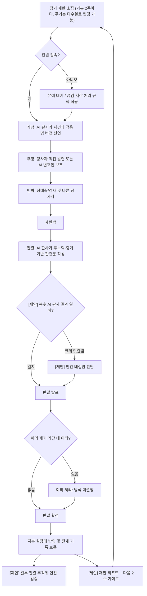

# pie-court 설계 문서

> 상태: 초안 (v0.2). 구현 코드는 아직 없습니다.
>
> 이 문서의 표기 규칙
> - **[결정]** 프로젝트 오너가 확정한 사항
> - **[제안]** 검토용으로 제시된 기능·아이디어. 채택 여부 미정
> - **[권장안]** 기술 선택 등에 대한 추천. 결정이 아님
> - 그 외 정해지지 않은 사항은 [11. 미결정 사항](#11-미결정-사항-open-questions)에 모읍니다.

---

## 목차

1. [목표와 철학](#1-목표와-철학)
2. [역할](#2-역할)
3. [핵심 흐름 개요](#3-핵심-흐름-개요)
4. [화면별 흐름](#4-화면별-흐름)
5. [재판 흐름도](#5-재판-흐름도)
6. [품질 기여도 평가 방식](#6-품질-기여도-평가-방식)
7. [지분 원장 (Share Ledger)](#7-지분-원장-share-ledger)
8. [입법: 판정 기준의 개정](#8-입법-판정-기준의-개정)
9. [데이터 모델 스케치](#9-데이터-모델-스케치)
10. [기술 아키텍처 (권장안)](#10-기술-아키텍처-권장안)
11. [미결정 사항 (Open Questions)](#11-미결정-사항-open-questions)
12. [참고 프로젝트](#12-참고-프로젝트)

---

## 1. 목표와 철학

### 문제

개인 게임 개발자가 협업을 하고 싶어도 **지분·수익 배분이 너무 어렵기 때문에** 협업 자체가 막힙니다. 누가 얼마나 기여했는지 사람끼리 직접 따지면 감정이 상하고, 미리 정한 고정 공식은 프로젝트가 진행되며 금방 현실과 어긋납니다.

### pie-court가 하는 일

pie-court는 각 협업자의 기여를 판정하고 지분을 계산하는 **"AI 법정" 웹 앱**입니다.

### 핵심 철학

- **정답을 맞히는 시스템이 아닙니다.** 기여 평가에 고정된 정답은 없고, 기준은 팀과 프로젝트에 따라 유동적입니다.
- 시스템의 역할은 그 **유동적인 기준을 붙잡아(명문화하고), 팀의 다수가 납득할 수 있는 절충안**을 만들어 내는 것입니다.
- **[결정] 부가 목표: 기여자들의 열의를 끌어올리기.** 지분을 공정하게 나누는 것에 더해, 정기 재판과 판결을 통해 기여가 인정받고 눈에 보이게 하여 팀원의 동기와 열의를 높이는 것도 이 프로젝트의 가치입니다 ([1.1](#11-부가-목표-기여자들의-열의-끌어올리기)).
- 이를 위해 판정 기준은 팀의 "법"으로 다루고, 법은 팀이 제안·투표로 개정합니다 ([8장](#8-입법-판정-기준의-개정)).
- **[결정] 평가의 주 기준은 "최종 결과물 품질에 대한 기여"이며, 투입 시간은 점수에서 제외합니다.** ([6장](#6-품질-기여도-평가-방식))
- **[결정] Slicing Pie의 시간·금액 시장가치 모델은 사용하지 않습니다.** Slicing Pie에서는 "지분이 계속 누적되고 재계산되는 원장"이라는 아이디어만 빌려옵니다 ([7장](#7-지분-원장-share-ledger)).

### 확정된 결정 요약

| # | 결정 |
|---|------|
| 1 | 브라우저 기반 **웹 앱**. 접근성을 위해 **법정 형태의 GUI** 사용 |
| 2 | 재판은 **모든 당사자가 동시에 접속한 실시간 재판**. 모두가 집중하는 중요한 의사결정 자리. 전체 재판 기록 보존, 판결 후 짧은 이의 제기 기간, 접속 끊김·지각 처리 |
| 3 | 각 당사자는 **직접 자기 권리를 주장**할 수 있고, **AI 변호인**을 선임해 도움을 받을 수 있음. 상대측(검사/반대측)과 **AI 판사** 역할 존재 |
| 4 | **Git 커밋이 기본 증거.** AI는 줄 수·커밋 수가 아니라 **커밋 내용(diff)** 을 읽음 |
| 5 | 주 기준은 **최종 결과물 품질 기여**. 시간은 점수에서 제외. Slicing Pie 시장가치 모델 미사용, 누적·재계산 원장 아이디어만 차용 |
| 6 | 판정 기준(가중치, 루브릭)은 팀의 **법**이며 제안·투표로 개정. **소급 적용 금지**: 개정은 개정 이후의 기여에만 적용 |
| 7 | 재판은 **정기적으로** 열림. 기본 **2주에 한 번**. 주기 자체도 법률 항목이며 **다수결로 변경 가능** |
| 8 | 부가 목표: 지분 계산뿐 아니라 **기여자들의 열의를 끌어올리기** |

### 1.1 부가 목표: 기여자들의 열의 끌어올리기

**[결정]** pie-court는 지분 계산 도구이면서, 기여자들의 동기와 열의를 높이는 장치이기도 합니다. 아래는 이를 위한 기능 **[제안]**이며 채택 여부는 미정입니다.

- **[제안] 재판별 리포트**: 재판마다 각자의 품질 기여 하이라이트와 "AI 판사가 무엇을 높이 평가했는지"를 정리한 리포트를 제공합니다. 숫자만이 아니라 **인정(recognition)** 을 전달하는 것이 목적입니다.
- **[제안] '다음 2주' 가이드**: AI 판사가 다음 재판까지 어떤 기여가 결과물 품질을 가장 많이 끌어올릴지 짧게 안내합니다.
- **[제안] 지분 변화 추이**: 재판 회차별 지분 변화를 추이 그래프로 보여 주어 노력이 눈에 보이게 합니다.
- **[제안] 공개 순위·망신 주기 지양**: 해로운 경쟁을 막기 위해 공개 랭킹이나 낮은 기여를 부각하는 표시는 피합니다. 순위를 보여 줄지 여부는 [미결정](#11-미결정-사항-open-questions)입니다.

---

## 2. 역할

| 역할 | 주체 | 설명 |
|------|------|------|
| **당사자 (Party)** | 사람 (팀원) | 자기 기여와 권리를 직접 주장. 증거 제출, 발언, 반박, 판결 후 이의 제기 가능. **[결정]** |
| **AI 변호인 (AI Counsel)** | AI | 당사자가 선임. 당사자 편에서 증거를 정리하고 논리를 세워 주장을 돕습니다. 당사자가 직접 말할 권리를 대체하지 않고 보조합니다. **[결정]** |
| **상대측 / 검사 (Opposing side / Prosecutor)** | 사람 또는 AI | 주장된 기여를 검증하고 반론을 제기하는 쪽. 다른 당사자 본인일 수도, AI일 수도 있음 (구체 구성은 [미결정](#11-미결정-사항-open-questions)). **[결정: 역할 존재]** |
| **AI 판사 (AI Judge)** | AI | 현행 법(루브릭)과 증거, 양측 주장을 근거로 판결과 지분 반영안을 냅니다. **[결정]** |
| **AI 판사 합의부 (복수 AI 판사)** | AI 2~3개 | 서로 다른 모델 2~3개가 독립적으로 판정해 교차 검증. **[제안]** |
| **인간 배심원 (Human Jurors)** | 사람 | AI 판사들의 판정이 크게 엇갈릴 때 투입되거나, AI 판결 일부를 무작위로 검증. **[제안]** |

---

## 3. 핵심 흐름 개요

```
팀 구성 & 합의서 서명
      │
      ▼
증거 수집 (Git 커밋 자동 수집 + 비코드 기여 제출)
      │
      ▼
정기 실시간 재판 (기본 2주마다) (개정 → 주장 → 반박 → 판결 → 이의 제기 기간)
      │
      ▼
지분 원장에 반영 (누적·재계산)  + [제안] 재판 리포트·다음 2주 가이드
      │
      └──► 입법 (기준 개정 제안 → 시뮬레이션 → 투표 → 시행) ──► 이후 재판에 적용
```

---

## 4. 화면별 흐름

### 4.1 팀 구성 & 합의 화면

1. 팀 생성: 프로젝트 이름, Git 저장소 연결, 팀원 초대.
2. 초기 법(판정 기준) 선택: 기본 루브릭 초안([6.3](#63-예시-루브릭-초안))으로 시작하거나 팀이 수정.
3. **[제안] 팀 합의서 작성·서명**
   - 팀 결성 시 앱 안에서 "팀원은 pie-court의 판결을 따른다"는 내용의 합의서를 생성합니다.
   - 모든 팀원이 서명(동의)해야 팀이 활성화됩니다.
   - 합의서와 이후 모든 판결 기록은 보존됩니다.
4. **[제안] 헌법 확정**: 소급 금지, 정족수 등 핵심 규칙을 헌법으로 지정 ([8.1](#81-헌법과-법률-제안)).

### 4.2 증거 수집·제출 화면

- **Git 커밋 (기본 증거) [결정]**
  - 연결된 저장소에서 커밋과 diff를 수집합니다.
  - AI는 줄 수·커밋 수 같은 양적 지표가 아니라 **diff 내용**을 읽고, 그 변경이 결과물 품질에 어떤 영향을 줬는지 평가합니다.
  - 양적 지표(PyDriller, git-fame 등으로 수집)는 참고 정보로만 표시할 수 있습니다.
- **[제안] 비코드 기여 증거**
  - 기획, 아트, 사운드, 테스트 등은 작업 로그, 파일, 링크, 스크린샷 등을 별도 증거로 제출합니다.
  - 목적: 평가가 프로그래머에게 유리하게 기울지 않도록 하기.
- 증거 목록 화면: 각 증거의 제출자, 날짜, 적용될 법 버전(해당 시점의 현행 법), AI 사전 분석 요약.

### 4.3 실시간 재판 화면 (법정 GUI)

법정 형태의 화면에 판사석, 당사자석, 변호인석, 상대측(검사)석, (제안 시) 배심원석이 배치됩니다. **모든 당사자가 동시에 접속한 상태에서 진행됩니다. [결정]**

- **정기 일정 [결정]**: 재판은 기본 **2주에 한 번** 정기적으로 열립니다. 각 재판은 직전 재판 이후 2주간의 기여(증거)를 다룹니다. 주기는 법률 항목이므로 다수결로 바꿀 수 있습니다. 주기의 기준일과 임시 재판 허용 여부는 [미결정](#11-미결정-사항-open-questions)입니다.
- 화면에는 다음 정기 재판 일시와 이번 회차에 다룰 증거 목록이 표시됩니다.

| 단계 | 내용 |
|------|------|
| **0. 소집·출석 확인** | 정기 일정(기본 2주)에 따라 소집 공지, 전원 접속 대기. 접속 끊김·지각 처리 규칙 적용 (아래 참고) |
| **1. 개정 (Opening)** | AI 판사가 사건(대상 기간·증거 범위)과 적용 법 버전을 선언 |
| **2. 주장 (Arguments)** | 각 당사자가 직접 또는 AI 변호인을 통해 자기 기여를 주장하고 증거 제시 |
| **3. 반박 (Rebuttal)** | 상대측(검사)과 다른 당사자가 반론, 당사자 재반박 |
| **4. 판결 (Verdict)** | AI 판사가 루브릭과 증거에 근거한 판결문(점수, 근거, 지분 반영안) 발표. [제안] 판례 인용, 복수 AI 판사 교차 검증 |
| **5. 이의 제기 기간 (Objection period)** | 판결 직후 짧은 이의 제기 기간. 이의가 없으면 확정되어 원장에 반영 |
| **6. [제안] 재판 리포트·다음 2주 가이드** | 각자의 품질 기여 하이라이트, AI 판사가 높이 평가한 점, 다음 2주에 품질을 가장 높일 기여 안내 ([1.1](#11-부가-목표-기여자들의-열의-끌어올리기)) |

- **전체 재판 기록 보존 [결정]**: 발언, 제출 증거, AI 판단 근거, 판결문, 이의 제기 내역을 모두 기록합니다.
- **접속 끊김·지각 처리 [결정: 처리 필요]**: 구체 규칙은 미정입니다. 검토 가능한 선택지(모두 **[제안]**):
  - 짧은 유예 시간 동안 재판 일시정지 후 재접속 대기
  - 유예 시간 초과 시 해당 당사자의 AI 변호인이 기존 제출 증거를 바탕으로 대리 진행
  - 지각자는 놓친 구간의 기록 요약을 받고 합류
- **이의 제기 처리 [미결정]**: 이의가 제기됐을 때 재심, 인간 배심원 회부, 재투표 중 무엇을 할지는 [11장](#11-미결정-사항-open-questions)에 있습니다.

### 4.4 입법 화면

1. **제안 (Propose)**: 팀원이 루브릭 항목·가중치 변경안을 제출하고 이유를 작성.
2. **[제안] 시뮬레이션 (Simulate)**: 투표 전, "새 기준을 과거 커밋에 적용했다면 각자의 지분이 어떻게 달라졌을지"를 보여줍니다. **실제로 소급 적용하는 것이 아니라** 판단을 돕기 위한 참고 자료입니다.
3. **투표 (Vote)**: 팀원 투표. 정족수·가결 기준은 [미결정](#11-미결정-사항-open-questions) ([제안] 헌법/법률 구분 시 각각 다름).
4. **시행 (Enact)**: 가결되면 새 법 버전이 생성되고, **시행 시점 이후의 기여에만 적용됩니다 (소급 금지) [결정]**.

---

## 5. 재판 흐름도



---

## 6. 품질 기여도 평가 방식

### 6.1 원칙 [결정]

- **주 기준: 최종 결과물 품질에 대한 기여.**
- **투입 시간은 점수에서 제외합니다.** 오래 일한 것 자체는 점수가 아니며, 결과물에 미친 영향만 평가합니다.
- AI는 각 기여가 최종 결과물 품질에 얼마나 영향을 줬는지 평가합니다. 예:
  - 핵심 기능인가?
  - 버그를 줄였는가?
  - 플레이 경험을 바꿨는가?
- 증거는 Git diff 내용을 기본으로 하고, 양적 지표(줄 수, 커밋 수)는 점수의 근거로 쓰지 않습니다.

### 6.2 평가 절차 (개요)

1. 증거 단위(커밋 또는 커밋 묶음, [제안] 비코드 증거)를 수집.
2. AI가 diff/증거를 읽고 현행 루브릭 항목별 점수와 **근거 문장**을 작성 (SplitSettl의 가중치·근거 리포트 형식 참고).
3. 재판에서 당사자 주장과 반박을 거쳐 AI 판사가 점수를 확정.
4. 확정 점수 × 해당 시점 법 버전의 가중치 = 기여 점수 → 원장에 반영.

### 6.3 예시 루브릭 (초안)

> ⚠️ **이 루브릭은 초기 초안일 뿐이며 확정된 기준이 아닙니다.** 항목과 가중치는 팀이 [입법 절차](#8-입법-판정-기준의-개정)로 개정하는 것을 전제로 합니다.

| 항목 | 질문 | 초안 가중치 |
|------|------|-------------|
| 핵심 기능 기여 | 이 기여가 게임의 핵심 기능·핵심 루프를 구현하거나 크게 개선했는가? | 30% |
| 플레이 경험 영향 | 플레이어가 체감하는 재미, 조작감, 연출, 몰입이 달라졌는가? | 25% |
| 안정성·버그 감소 | 크래시나 버그를 줄였는가? 회귀를 막았는가? | 20% |
| 완성도·폴리싱 | 아트, 사운드, UI, 텍스트 등 결과물의 완성도를 높였는가? | 15% |
| 기반·확장성 | 다른 기여를 가능하게 하거나 쉽게 만든 구조적 작업인가? | 10% |

- 각 항목은 예를 들어 0~5점으로 채점하고 근거를 함께 기록하는 방식이 가능합니다 (척도도 초안).
- 다음은 **채점에서 제외**합니다: 투입 시간, 줄 수, 커밋 수 그 자체.
- 결과물에 남지 않은(삭제·되돌려진) 작업을 어떻게 볼지는 [미결정](#11-미결정-사항-open-questions)입니다.

### 6.4 [제안] 판정 품질 보강 장치

- **판례**: AI 판사가 이전 판결을 인용해 비슷한 기여에 비슷한 판단을 내리도록 일관성을 유지.
- **복수 AI 판사 교차 검증**: 서로 다른 모델 2~3개가 독립 판정. 결과가 크게 엇갈리면 인간 배심원에게 넘김.
- **무작위 인간 검증**: Deep Funding처럼 AI가 제안하고, 사람이 일부 판결을 무작위로 골라 검증·보정.
- **비코드 기여 평가**: 기획·아트·사운드·테스트를 별도 증거로 받아 같은 루브릭(또는 직군별 보정 루브릭)으로 평가.

---

## 7. 지분 원장 (Share Ledger)

- **[결정] Slicing Pie에서는 "지분이 계속 누적되고 재계산되는 원장" 아이디어만 빌립니다.** 시간·금액을 시장가치로 환산하는 Slicing Pie 공식은 사용하지 않습니다.
- 원장은 확정된 판결만 기록하는 **추가 전용(append-only)** 기록입니다 ([권장안]).
- 각 항목: 판결 ID, 기여자, 기여 점수, 적용된 법 버전, 확정 시각.
- 지분율 = 개인 누적 기여 점수 ÷ 팀 전체 누적 기여 점수 (기본 형태. 세부 방식은 미결정).
- **소급 금지 [결정]**: 법이 개정돼도 이미 확정된 항목의 점수는 다시 계산하지 않습니다. 새 법은 시행 이후 기여에만 적용됩니다.
- 화면: 현재 지분 파이 차트, 재판 회차별 지분 변화 추이 그래프([제안], [1.1](#11-부가-목표-기여자들의-열의-끌어올리기)), 항목별로 판결문·재판 기록으로 바로 이동.

---

## 8. 입법: 판정 기준의 개정

### 원칙 [결정]

- 판정 기준(루브릭 항목, 가중치)은 팀의 **법**입니다.
- 법은 **제안 → 투표**를 거쳐 개정합니다.
- **소급 금지**: 개정된 법은 개정 이후의 기여에만 적용됩니다.
- **재판 주기도 법률 항목입니다 [결정]**: 기본값은 2주에 한 번이며, 다수결로 변경할 수 있습니다.
- 모든 법은 버전으로 관리되며, 모든 기여·판결은 어느 법 버전으로 평가됐는지 기록합니다.

### 8.1 헌법과 법률 [제안]

| 구분 | 내용 예시 | 개정 요건 (제안) |
|------|-----------|------------------|
| **헌법** | 소급 금지, 정족수, 투표 방식, 합의서 효력 | 만장일치 |
| **법률** | 루브릭 항목, 세부 가중치, 채점 척도, 재판 주기 | 다수결 (재판 주기는 [결정]) |

### 8.2 개정 시뮬레이션 [제안]

- 투표 전에 "새 기준을 과거 커밋에 적용했다면 각자의 지분이 어떻게 바뀌었을지"를 보여줍니다.
- 팀원이 개정안의 효과를 이해하고 투표하도록 돕는 **참고용**이며, 결과는 원장에 반영되지 않습니다 (소급 금지).

---

## 9. 데이터 모델 스케치

> 개념 수준의 스케치입니다. 필드와 관계는 구현 시 바뀔 수 있습니다.

```
Team            { id, name, repo_url, created_at, current_law_version_id }
Member          { id, team_id, user_id, display_name, joined_at, status }
Agreement       { id, team_id, text, created_at }                      # [제안] 팀 합의서
AgreementSign   { agreement_id, member_id, signed_at }

LawVersion      { id, team_id, version_no, rubric(json), weights(json),
                  trial_cadence_days(기본 14),
                  enacted_at, parent_version_id }
ConstitutionRule{ id, team_id, key, value, amend_rule }                # [제안] 헌법

Evidence        { id, team_id, member_id, type(commit|nonCode),
                  commit_sha?, diff_ref?, files?, description,
                  created_at, law_version_id }                          # 기여 시점의 현행 법
AIAssessment    { id, evidence_id, model, scores(json), rationale, created_at }

Trial           { id, team_id, scope(period/evidence ids), law_version_id,
                  status(scheduled|in_session|verdict|objection|closed),
                  scheduled_at, started_at, closed_at }
TrialParticipant{ trial_id, member_id?, role(party|counsel|opposing|judge|juror),
                  is_ai, model?, connection_log(json) }
TrialEvent      { id, trial_id, seq, phase, speaker_id, kind(speech|evidence|ruling|objection|system),
                  content, created_at }                                 # 전체 재판 기록
Verdict         { id, trial_id, per_member_scores(json), rationale,
                  cited_precedents[], issued_at, finalized_at }
TrialReport     { id, trial_id, member_id, highlights, judge_valued,
                  next_period_guidance, created_at }                    # [제안] 재판 리포트
Objection       { id, verdict_id, member_id, reason, status, created_at }

LedgerEntry     { id, team_id, verdict_id, member_id, score,
                  law_version_id, finalized_at }                        # append-only

Proposal        { id, team_id, author_id, kind(statute|constitution),
                  diff_from_version_id, new_rubric(json), reason,
                  simulation_result(json)?, status, created_at }
Vote            { proposal_id, member_id, choice, voted_at }
```

---

## 10. 기술 아키텍처 (권장안)

> ⚠️ 아래는 모두 **권장안(suggestion)이며 결정이 아닙니다.**

| 영역 | 권장안 | 비고 |
|------|--------|------|
| 프론트엔드 | React/Next.js 또는 SvelteKit | 법정 GUI는 일반 웹 UI + 일러스트/애니메이션으로 시작. 게임 엔진 기반 연출은 선택지 |
| 실시간 통신 | WebSocket (Socket.IO 등) 또는 관리형 실시간 서비스 (Supabase Realtime, Liveblocks, Ably 등) | 출석·끊김 감지, 발언 순서 제어, 재접속 시 기록 재동기화 필요 |
| 백엔드 | Node.js(TypeScript) 또는 Python(FastAPI) | Python을 쓰면 PyDriller·LangGraph와 바로 연동 |
| 재판 오케스트레이션 | [LangGraph](https://github.com/langchain-ai/langgraph) (MIT) | 재판 단계를 상태 그래프로 표현, 사람 개입(interrupt) 지점 지원 |
| 증거 수집 | [PyDriller](https://github.com/ishepard/pydriller), [git-fame](https://github.com/casperdcl/git-fame), GitHub API | 커밋·diff 수집. 양적 지표는 참고용 |
| AI 판정 | 복수 LLM 제공자 사용 가능한 구조 | [제안] 교차 검증을 위해 모델 교체가 쉬운 추상화 |
| 저장소 | PostgreSQL | 원장·재판 기록은 append-only 테이블, 법 버전은 JSON 컬럼 |
| 인증 | GitHub OAuth | 커밋 작성자와 팀원 계정 매핑에 유리 |

설계 시 고려 사항:
- 재판 기록(`TrialEvent`)은 이벤트 소싱처럼 순서 번호와 함께 저장하면 재접속·재생·감사에 유리합니다.
- AI 호출은 비용과 지연이 크므로 커밋 사전 분석(`AIAssessment`)은 재판 전에 비동기로 미리 돌리는 방식이 유리합니다.
- [ChatEval](https://github.com/thunlp/ChatEval), [Multi-Agents-Debate](https://github.com/Skytliang/Multi-Agents-Debate)는 토론·판정 설계의 **아이디어만** 참고합니다. Multi-Agents-Debate는 GPL 라이선스이므로 **코드를 복사하지 않습니다.**

---

## 11. 미결정 사항 (Open Questions)

아직 정하지 않은 사항입니다. 정해지면 이 문서에 반영합니다.

**재판 운영**
1. 2주 주기의 기준: 팀 결성일부터 2주마다인가, 고정 요일(예: 격주 토요일)인가
2. 정기 재판 외에 긴급·임시 재판을 요청할 수 있는가 (요청 요건 포함)
3. 접속 끊김·지각의 구체 규칙 (유예 시간, AI 변호인 대리 진행 허용 여부, 불참 시 판결 효력)
4. 이의 제기 기간의 길이와, 이의 제기 후 처리 방식 (재심, 인간 배심원 회부, 팀 투표 등)
5. 상대측(검사)은 누가 맡는가? (다른 당사자, AI 검사, 둘 다)
6. 재판에서 사람의 발언 수단 (텍스트 채팅만 / 음성 포함)
7. AI 변호인의 성향·권한 범위 (당사자가 지시 가능한 범위, 당사자에게 불리한 사실 처리)

**평가 기준**
8. 초기 루브릭의 실제 항목과 가중치 (6.3은 초안일 뿐)
9. 결과물에서 삭제되거나 되돌려진 작업, 실패했지만 방향을 정해 준 실험을 어떻게 평가할지
10. 품질 영향은 언제 판단하는가? (커밋 직후 vs 출시 시점 등 나중에 재평가 — 소급 금지와의 관계 포함)
11. 금전 투자, 마케팅, 운영 등 결과물 바깥의 기여를 다룰지 여부

**입법·거버넌스**
12. 정족수와 가결 기준 (단순 과반, 2/3 등)
13. 헌법/법률 구분 채택 여부 (제안 단계)
14. 팀원 합류·탈퇴 시 지분 처리 (탈퇴자 지분 유지 / 동결 / 매입 등)
15. 판결 및 합의서의 법적 효력을 어디까지 기대할지 (실제 계약서와의 관계)

**지분 계산**
16. 원장에서 지분율을 계산하는 정확한 방식 (단순 비율 외 보정 여부)
17. 지분과 실제 수익 배분의 연결 방식 (정산 주기, 지분 확정 시점)

**열의·동기 부여**
18. 팀원 간 순위(랭킹)를 보여 줄 것인가, 보여 준다면 누구에게 어떤 형태로 (공개 순위·망신 주기는 지양하는 방향이 [제안])
19. 재판 리포트, 다음 2주 가이드, 지분 추이 그래프 도입 여부 (모두 제안 단계)

**AI·운영**
20. 사용할 AI 모델과 비용 부담 주체
21. 복수 AI 판사·인간 배심원·무작위 검증 도입 여부와 범위 (모두 제안 단계)
22. 비공개 저장소 코드와 비코드 증거 파일의 보안·개인정보 처리
23. 여러 팀·프로젝트를 한 계정으로 운영하는 경우 지원 여부, 서비스 형태 (셀프 호스팅 / 호스팅 서비스)

---

## 12. 참고 프로젝트

| 프로젝트 | 용도 | 비고 |
|----------|------|------|
| [PyDriller](https://github.com/ishepard/pydriller) | 커밋·diff 수집 | 증거 수집 |
| [git-fame](https://github.com/casperdcl/git-fame) | 코드 소유권 통계 | 참고 지표 (점수 근거 아님) |
| [LangGraph](https://github.com/langchain-ai/langgraph) | 재판 절차 오케스트레이션 | MIT |
| [ChatEval](https://github.com/thunlp/ChatEval) | 멀티에이전트 토론·평가 설계 | 아이디어 참고 |
| [Multi-Agents-Debate](https://github.com/Skytliang/Multi-Agents-Debate) | 토론·판정 설계 | 아이디어만 참고, GPL이므로 코드 복사 금지 |
| [Deep Funding](https://github.com/deepfunding/dependency-graph) | AI 제안 + 사람 무작위 검증 구조 | 무작위 인간 검증 제안의 근거 |
| [SplitSettl](https://github.com/flip18731/SplitSettl) | LLM diff 채점 가중치와 근거 리포트 형식 | 참고용 |
| [Slicing Pie](https://slicingpie.com) | 누적·재계산 지분 원장 아이디어 | 시간·금액 시장가치 모델은 사용하지 않음 |
